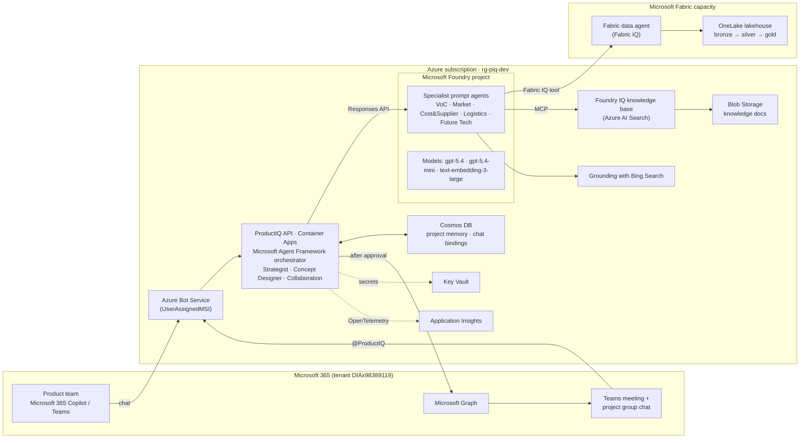

# ProductIQ – agentic product-innovation copilot

> Microsoft PSA **Hack to Build 2026** · Microsoft Foundry · Microsoft Agent Framework · Microsoft Fabric
> Demo company: **Contoso Home Appliances** (fictional). **All data is synthetic; every KPI is a target.**

ProductIQ helps product development teams decide faster what to improve and what to build next. It combines customer feedback, market trends, cost, supplier availability and logistics data into **evidence-backed, ranked product options with a scorecard and citations**. It then carries that context into the team's Teams meeting and group chat, so no one has to re-explain it.

A product manager asks in **Microsoft 365 Copilot** (or the web app). ProductIQ's specialist agents reason over **Fabric** data (through **Fabric IQ** and a Fabric data agent), the **Foundry IQ** knowledge base and the web, and propose options. After the PM **approves**, ProductIQ creates a **Teams meeting and project group chat**, joins the chat and answers @mentions from shared **project memory**.

---

## Contents
1. [Architecture](#1-architecture)
2. [Repository layout](#2-repository-layout)
3. [What gets deployed](#3-what-gets-deployed)
4. [Prerequisites](#4-prerequisites)
5. [Tenant settings checklist (one-time, admin)](#5-tenant-settings-checklist-one-time-admin)
6. [Quick start](#6-quick-start)
7. [Step-by-step setup manual](#7-step-by-step-setup-manual)
8. [Try the scenario](#8-try-the-scenario)
9. [Upload this repository to GitHub](#9-upload-this-repository-to-github)
10. [CI/CD with GitHub Actions](#10-cicd-with-github-actions)
11. [Cost control and clean-up](#11-cost-control-and-clean-up)
12. [Troubleshooting](#12-troubleshooting)
13. [Preview features and known limitations](#13-preview-features-and-known-limitations)

Related docs: [Build plan](docs/BUILD-PLAN.md) · [Architecture](docs/ARCHITECTURE.md) · [Data model](docs/DATA-MODEL.md) · [Security & Responsible AI](docs/SECURITY.md) · [App code](src/README.md) · [Synthetic data](data/README.md)

---

## 1. Architecture



**Request flow:** (1) user asks in Copilot/Teams → (2) Bot Service → ProductIQ API → (3) orchestrator loads user + project memory → (4) specialists run **in parallel** using Fabric IQ, Foundry IQ and Bing → (5) Concept Designer builds options; the **scorecard is computed in code** from cited numbers → (6) user approves the meeting → (7) Graph creates the meeting and chat, installs ProductIQ and binds `projectId ↔ chatId` → (8) members @mention ProductIQ, which answers from project memory → (9) traces and evaluations go to Application Insights.

**Data pipeline:** synthetic source systems (ERP, PLM, CRM/service, e-commerce reviews, supplier and logistics systems, market feeds) → OneLake `Files/bronze` → notebook 01 (clean, dedupe, conform, sentiment + topic) → `silver_*` → notebook 02 (star schema) → gold `dim_*`/`fact_*` → **ProductIQ Data Agent** → Fabric IQ tool in Foundry.

An interactive version is in the project files (`ProductIQ-Architecture.html`).

## 2. Repository layout

```
productiq/
├─ README.md                    ← this manual
├─ config/
│  ├─ environment.sample.json   ← template
│  └─ environment.json          ← YOUR tenant/subscription (git-ignored)
├─ docs/                        ← BUILD-PLAN, ARCHITECTURE, DATA-MODEL, SECURITY, CONTRACT (shared names)
├─ infra/
│  ├─ main.bicep                ← subscription-scope entry point
│  ├─ main.bicepparam
│  ├─ modules/*.bicep           ← identity, monitoring, keyvault, storage, cosmos, search, bing, foundry, containerapps, botservice, fabric, roles
│  └─ arm/                      ← ARM JSON compiled from Bicep (CI or scripts/build-arm.ps1)
├─ scripts/
│  ├─ 00-check-prereqs.ps1 … 12-run-evals.ps1, deploy-all.ps1, fabric-capacity.ps1, 99-teardown.ps1
│  ├─ lib/                      ← shared PowerShell + Python helpers
│  ├─ fabric/                   ← workspace, lakehouse, OneLake upload, notebooks, data agent
│  └─ foundry/                  ← knowledge base, connections, specialist agents (+ instructions), smoke test
├─ data/generator/              ← synthetic data generator (24 months, scenario signals validated)
├─ fabric/
│  ├─ notebooks/                ← 01 bronze→silver, 02 silver→gold, 03 create data agent
│  └─ data-agent/               ← instructions, data source instructions, example queries
├─ src/                         ← ProductIQ API (Agent Framework orchestrator, Teams bot, memory, Graph)
├─ tests/                       ← unit tests (no Azure needed)
├─ teams-app/                   ← Teams / Microsoft 365 Copilot app manifest template + icons
├─ eval/                        ← golden Q&A + red-team set, evaluation runner
└─ .github/workflows/           ← ci, build-arm, deploy (OIDC)
```

## 3. What gets deployed

| Resource | Name pattern | Purpose |
|---|---|---|
| Resource group | `rg-piq-dev` | Everything Azure for one environment |
| User-assigned managed identity | `id-piq-app-dev` | App + bot identity (no secrets) |
| Microsoft Foundry resource + project | `ais-piq-dev-*` / `proj-piq-dev` | Agent Service, models, connections, tracing, evaluations |
| Model deployments | `gpt-5.4`, `gpt-5.4-mini`, `text-embedding-3-large` | Synthesis, specialists, embeddings (change in config) |
| Azure AI Search (Basic) | `srch-piq-dev-*` | Foundry IQ knowledge base (agentic retrieval) |
| Grounding with Bing Search | `bing-piq-dev-*` | Public market/tech trends (optional) |
| Azure Cosmos DB (serverless) | `cosmos-piq-dev-*` | Sessions, project memory, chat bindings, scorecards, decisions, audit |
| Storage account | `stpiqdev*` | `knowledge` container for the knowledge base |
| Key Vault | `kv-piq-dev-*` | Graph app secret, demo user passwords |
| Log Analytics + Application Insights | `log-…`, `appi-…` | OpenTelemetry traces, logs |
| Container Registry + Container Apps | `crpiqdev*`, `ca-piq-api-dev` | ProductIQ API (`/api/messages`, `/api/ask`) |
| Azure Bot Service | `bot-piq-dev-*` | Teams + Microsoft 365 Copilot channels, `graph-sso` OAuth connection |
| Fabric capacity | `fcpiqdev*` (F2 default) | Fabric workspace, lakehouse, notebooks, data agent |
| **Created by scripts (not Bicep)** | | Entra app `ProductIQ-Graph-dev`, Fabric workspace/lakehouse/notebooks/data agent, AI Search knowledge source/base, Foundry RemoteTool connections and agents, Teams app, optional demo users/Team |

All data-plane access is **Entra ID only** (`disableLocalAuth` on Foundry and Cosmos DB, shared keys off on Storage) and uses **least-privilege RBAC** (`infra/modules/roles.bicep`).

## 4. Prerequisites

**Your environment** (already filled in `config/environment.json`):

| Setting | Value |
|---|---|
| Microsoft 365 tenant | `DIAx98389119.onmicrosoft.com` |
| Directory (tenant) ID | `95a2f129-68f0-42a9-83ba-7ec99851cab1` |
| Azure subscription | `ME-DIAx98389119-cllucas-2` |
| Subscription ID | `b8b93722-85fc-47bc-a887-6501eb7fdcb2` |
| Region | `eastus2` (change `location` if you prefer, e.g. `japaneast`, after checking model availability) |

**Roles** for the person running the scripts:
- Azure: **Owner** on the subscription (or Contributor + Role Based Access Control Administrator), because the templates create role assignments.
- Entra ID: **Application Administrator** + **Global Administrator** (admin consent), **User Administrator** for demo users.
- Microsoft 365: **Teams Administrator** (org app catalog), **Fabric Administrator** (tenant settings).
- Licences: Microsoft 365 E3/E5 + Teams for demo users; **Microsoft 365 Copilot** licence to use the agent inside Copilot; Fabric capacity is deployed by Bicep.

**Tools** (Windows, macOS or Linux):
- PowerShell 7.4+ · Azure CLI 2.65+ (with Bicep) · Python 3.11+ · Git · (optional) GitHub CLI `gh`, VS Code with the Microsoft 365 Agents Toolkit and Foundry Toolkit
- `scripts/00-check-prereqs.ps1` checks these, installs the Microsoft Graph PowerShell modules and creates `.venv` with `scripts/requirements.txt`.

## 5. Tenant settings checklist (one-time, admin)

**Microsoft Fabric admin portal** (`app.fabric.microsoft.com` → Settings → Admin portal → Tenant settings):
- [ ] *Users can create Fabric items* – enabled (at least for your security group)
- [ ] *Copilot and Azure OpenAI Service* – enabled
- [ ] *Users can create and share Data agent item types (preview)* – enabled
- [ ] *Data sent to Azure OpenAI can be processed outside your capacity's geographic region…* and *…stored outside…* (cross-geo processing/storing for AI) – enabled if your capacity region requires it
- [ ] *Service principals can use Fabric APIs* – enabled (lets the app identity read the workspace)

**Teams admin center** (`admin.teams.microsoft.com`):
- [ ] Teams apps → Manage apps → *Org-wide app settings*: allow custom apps
- [ ] Setup/permission policies allow custom apps for the demo users (or the global policy)
- [ ] Resource-specific consent for chats allowed (Teams apps → Permissions)

**Microsoft 365 admin center** → Copilot → Agents: allow custom engine agents built for your org for the demo users.

**Azure**: the subscription has quota for the chosen models (GlobalStandard) in the region. If not, change model names/region in `config/environment.json`.

## 6. Quick start

```powershell
git clone https://github.com/<you>/productiq.git
cd productiq
# config/environment.json is git-ignored; create it from the sample if it is missing:
#   Copy-Item config/environment.sample.json config/environment.json   (then edit)
pwsh ./scripts/deploy-all.ps1          # runs 00 → 11; resume with -From <n>
pwsh ./scripts/12-run-evals.ps1        # optional: evaluation report
```

Total time on a fresh tenant is about 60–90 minutes. Most of that is the first infrastructure deployment (10–25 min), Fabric Spark jobs (5–15 min) and knowledge ingestion (2–10 min).

## 7. Step-by-step setup manual

Each script is **idempotent**: re-run it after fixing a problem. Values discovered along the way are saved to `config/outputs.json` and `.env` (both git-ignored).

### Step 0 – Check tools · `scripts/00-check-prereqs.ps1`
Creates `.venv` and installs the Python and PowerShell dependencies. ✅ *All prerequisites OK.*

### Step 1 – Sign in · `scripts/01-login.ps1`
Signs in to the Azure CLI (tenant `95a2f129-…`), selects subscription `b8b93722-…`, registers resource providers and signs in to Microsoft Graph PowerShell with the admin scopes it needs.

### Step 2 – Deploy Azure infrastructure · `scripts/02-deploy-infra.ps1`
- Preview first: `./scripts/02-deploy-infra.ps1 -WhatIf`
- Deploys `infra/main.bicep` at subscription scope (see [section 3](#3-what-gets-deployed)).
- ✅ Check: Azure portal → `rg-piq-dev`. Open the Foundry project in **ai.azure.com** and confirm the three model deployments.
- ARM alternative: `./scripts/build-arm.ps1`, then deploy `infra/arm/azuredeploy.json` (see `infra/arm/README.md`).

### Step 3 – Entra app, Teams SSO and bot OAuth · `scripts/03-setup-entra.ps1`
Creates `ProductIQ-Graph-dev` with **delegated** Graph permissions:
- `Calendars.ReadWrite`, `OnlineMeetings.ReadWrite`
- `Chat.Create`, `Chat.ReadWrite`, `ChatMessage.Send`
- `TeamsAppInstallation.ReadWriteForChat`
- `People.Read`, `User.Read`

It also:
- grants admin consent
- sets the Teams SSO identifier URI `api://botid-<bot id>` and pre-authorises Teams/Microsoft 365 clients
- stores the client secret **only in Key Vault**
- re-deploys so the Azure Bot gets the `graph-sso` OAuth connection

✅ Check: Azure Bot → Configuration → OAuth connection settings → `graph-sso` → **Test connection**.

### Step 4 – Generate synthetic data · `scripts/04-generate-data.ps1`
Runs `data/generator/generate_data.py` (seed 42) to produce 24 months (Nov 2024 – Oct 2026) of Contoso data and knowledge documents in `data/output/`. The generator **validates the scenario signals** and fails if any is off:
- pet-hair tangling is the #1 pet-owner complaint (≈ 31%)
- pet-care cleaning demand is up 12% year over year
- the BLM-200 motor has one supplier running at ≈ 85% utilisation
- adding a second supplier takes 42 days

It then builds `eval/golden_qa.jsonl` from the same data. Details: [data/README.md](data/README.md), [docs/DATA-MODEL.md](docs/DATA-MODEL.md).

### Step 5 – Microsoft Fabric · `scripts/05-setup-fabric.ps1`
This step:
1. resumes the capacity if it is paused
2. creates workspace **ProductIQ-dev** on it and gives the app identity Viewer access
3. creates lakehouse **productiq_lakehouse**
4. uploads the bronze CSVs to OneLake
5. imports and runs notebooks **01_bronze_to_silver** and **02_silver_to_gold**
6. creates and publishes **ProductIQ Data Agent** with the Fabric data agent SDK (preview)

- If the SDK step fails, open notebook **03_create_data_agent** in the workspace, run it, then re-run with `-SkipUpload -SkipRun`.
- ✅ Check in Fabric: the gold tables (`dim_*`, `fact_*`) exist. Open the data agent and ask *"What share of negative pet-owner reviews in the last 18 months mention hair tangling?"* (expected ≈ 31%).
- Optional (recommended for judging):
  - create a **Direct Lake semantic model** on the gold tables
  - create a **Fabric IQ ontology (preview)** with the entities Product, Component, Supplier, Feedback, so business terms map to the data

### Step 6 – Foundry IQ knowledge base · `scripts/06-setup-knowledge.ps1`
- Uploads the knowledge documents to Blob Storage.
- Creates blob knowledge source `productiq-docs-ks`. AI Search then builds the data source, skillset, index and indexer, and vectorises with `text-embedding-3-large` using its managed identity.
- Creates knowledge base **productiq-kb** and runs a test retrieval.
- ✅ Check: Foundry portal → Knowledge → `productiq-kb`.

### Step 7 – Foundry connections and specialist agents · `scripts/07-setup-foundry.ps1`
Creates two RemoteTool connections:
- **`fabriciq-dataagent`**: Fabric IQ → data agent MCP endpoint, passing through the user's identity
- **`foundryiq-kb`**: knowledge base MCP endpoint, using the project managed identity

It then creates five prompt agents with the instructions in `scripts/foundry/agents/`:
- `productiq-voc-analyst`
- `productiq-market-scout`
- `productiq-cost-supplier`
- `productiq-logistics`
- `productiq-future-tech`

Finally it runs a smoke test.

If you call agents with the app's managed identity rather than a signed-in user, use `-FabricAuth project` and make sure the identity can read the Fabric workspace. Portal alternative for Fabric IQ: Agent → Tools → Add → **Fabric IQ (OneLake Catalog)** → select *ProductIQ Data Agent*.

### Step 8 – Microsoft 365 demo setup (optional) · `scripts/08-setup-m365.ps1`
- Creates the fictional users **Aiko Tanaka** (PM), **Ken Sato** (design), **Maria Garcia** (sourcing) and **Raj Patel** (supply chain). Initial passwords are stored in Key Vault, and licences are assigned if free seats exist.
- Creates the Microsoft 365 group and Team **Contoso Product Development**.
- Uploads the knowledge documents to its SharePoint library under *ProductIQ Knowledge*.

Skip this step if you use real test accounts.

### Step 9 – Build the Teams / Copilot app · `scripts/09-build-teams-app.ps1`
Fills `teams-app/manifest.template.json` (manifest 1.22) and zips it to `teams-app/build/`. The manifest includes:
- the custom engine agent (`copilotAgents.customEngineAgents`)
- bot scopes: personal, team, groupChat, copilot
- Teams SSO (`webApplicationInfo`)
- resource-specific consent: `ChatMessage.Read.Chat`, `ChatMember.Read.Chat`

### Step 10 – Publish to the org catalog · `scripts/10-publish-teams-app.ps1`
Uploads (or updates) the app in the Teams org catalog through Microsoft Graph and stores `TEAMS_APP_CATALOG_ID`. The Collaboration Agent needs that ID to install ProductIQ into new group chats.

### Step 11 – Deploy the app · `scripts/11-deploy-app.ps1`
Builds `src/` in **Azure Container Registry** (no local Docker), rolls it out to Container Apps, switches ingress to port 8000 and checks `/healthz`.

### Step 12 – Evaluate · `scripts/12-run-evals.ps1`
Runs `eval/golden_qa.jsonl` (data questions plus red-team prompts) against `/api/ask` and writes `eval/results/`. For groundedness, relevance and task adherence, also use **Foundry evaluations** on the traced runs (portal → Evaluation).

### Run the app locally (development)
```powershell
cd productiq; . .venv/bin/Activate.ps1      # Windows: .venv\Scripts\Activate.ps1
pip install -r src/requirements.txt
$env:PYTHONPATH = 'src'; python -m productiq.app   # reads .env; http://localhost:8000/healthz
```
To test the bot locally, use the **Microsoft 365 Agents Playground** or a **Dev Tunnel**, and point the Azure Bot messaging endpoint to the tunnel. See [src/README.md](src/README.md).

## 8. Try the scenario
1. Sign in as Aiko Tanaka and open **Microsoft 365 Copilot** → ProductIQ. Ask: *"What new product should we build for pet owners next year, and can we make it?"*
2. ProductIQ returns three options with a weighted scorecard and citations. Option C (pet-care robot vacuum) is recommended, and the supplier risk on BLM-200 is flagged.
3. Ask: *"Set up a meeting with Ken, Maria and Raj this Thursday and include ProductIQ."* Review the approval card and click **Approve**.
4. In the new Teams group chat, Maria asks *"@ProductIQ what was the supplier risk for option C?"* ProductIQ answers from project memory.
5. Ken asks *"@ProductIQ re-score option C using the current motor platform"*. The scorecard is updated and the decision is logged.

## 9. Upload this repository to GitHub

> Use a **private** repository. `config/environment.json`, `config/outputs.json`, `.env` and `data/output/` are git-ignored, so tenant-specific values and generated data are not pushed.

**Option A – GitHub CLI**
```powershell
cd productiq
git init -b main
git add .
git commit -m "ProductIQ – Hack to Build 2026 initial import"
gh auth login
gh repo create productiq --private --source . --remote origin --push
```

**Option B – GitHub website**
1. Create an empty **private** repository named `productiq` (no README or .gitignore) at github.com/new.
2. Then run:
```powershell
git init -b main
git add .
git commit -m "ProductIQ – Hack to Build 2026 initial import"
git remote add origin https://github.com/<your-account>/productiq.git
git push -u origin main
```
After the first push, the **build-arm** workflow compiles `infra/main.bicep` and commits `infra/arm/azuredeploy.json`. Enable *Settings → Actions → General → Workflow permissions → Read and write* for that.

Before pushing, run `git status` and check that no `.env`, `outputs.json` or secrets are staged.

## 10. CI/CD with GitHub Actions
- **ci.yml**: Bicep build + lint, Python compile, unit tests, small-scale data generation and validation, JSON checks, PowerShell lint.
- **build-arm.yml**: Bicep → ARM, committed back to the repository.
- **deploy.yml** (manual): what-if, infra or app deployment using **OpenID Connect**, so no Azure secrets are stored in GitHub.

One-time OIDC setup:
```powershell
$app = az ad app create --display-name productiq-github | ConvertFrom-Json
az ad sp create --id $app.appId | Out-Null
az ad app federated-credential create --id $app.id --parameters (@{
  name='github-dev'; issuer='https://token.actions.githubusercontent.com'
  subject='repo:<your-account>/productiq:environment:dev'; audiences=@('api://AzureADTokenExchange') } | ConvertTo-Json -Compress)
$spId = az ad sp show --id $app.appId --query id -o tsv
az role assignment create --assignee-object-id $spId --assignee-principal-type ServicePrincipal --role Contributor --scope /subscriptions/b8b93722-85fc-47bc-a887-6501eb7fdcb2
az role assignment create --assignee-object-id $spId --assignee-principal-type ServicePrincipal --role "Role Based Access Control Administrator" --scope /subscriptions/b8b93722-85fc-47bc-a887-6501eb7fdcb2
```
Then add these repository **variables**: `AZURE_CLIENT_ID` (= `$app.appId`), `AZURE_TENANT_ID`, `AZURE_SUBSCRIPTION_ID`, `AZURE_LOCATION`, `DEPLOYER_PRINCIPAL_ID` (= `$spId`), and create a GitHub environment named `dev`.

## 11. Cost control and clean-up
- **Fabric capacity** bills while Active. Pause it whenever you stop working: `./scripts/fabric-capacity.ps1 -Action Suspend` (and `-Action Resume` to start again).
- AI Search Basic, Container Apps (min 1 replica), Cosmos DB serverless, Bot F0 and Log Analytics cost little. Model calls are pay-per-token.
- Check *Cost Management* daily during the build (the subscription is a demo subscription).
- Tear down: `./scripts/99-teardown.ps1 [-IncludeEntra] [-IncludeDemoUsers]`. Delete the Fabric workspace in the Fabric portal. The Foundry resource and Key Vault stay soft-deleted; purge them before redeploying the same names.

## 12. Troubleshooting

| Symptom | Fix |
|---|---|
| `InsufficientQuota` / model not available | Change `models.*.name` or `location` in `config/environment.json`; leave `version` empty to use the default version |
| `RoleAssignmentExists` or `AuthorizationFailed` on role assignments | You need Owner (or RBAC Administrator) on the subscription |
| Fabric API 401/403 | Check Fabric tenant settings; make sure you are a capacity admin (`fabricAdminUpn`) and the capacity is **Active** |
| Notebook job fails | Open the notebook run in Fabric (Monitor hub). Usually the bronze files are missing → rerun step 5 without `-SkipUpload` |
| Data agent SDK error | Run notebook `03_create_data_agent` in Fabric, then rerun step 5 with `-SkipUpload -SkipRun` |
| Fabric IQ tool `CONSENT_REQUIRED` | Open the consent link from the error once as the user. For app-only calls use `-FabricAuth project` |
| Knowledge base 403 | Project managed identity needs *Search Index Data Reader* (assigned in `roles.bicep`); wait ~5 min for RBAC propagation |
| Bot does not answer in Teams | Container app healthy? Bot messaging endpoint `https://<fqdn>/api/messages`? Teams channel enabled? App allowed in Teams admin center? |
| SSO / OAuth card loops | `graph-sso` *Test connection*; identifier URI `api://botid-<BOT_APP_ID>`; redirect URI `https://token.botframework.com/.auth/web/redirect` |
| Group chat install fails | `TEAMS_APP_CATALOG_ID` set? App published in org catalog? `TeamsAppInstallation.ReadWriteForChat` consented? |

## 13. Preview features and known limitations
- **Preview:** Fabric IQ tool (`fabric_iq_preview`), Fabric data agent and its SDK, knowledge base MCP endpoint (`2026-08-01-preview`), RemoteTool connections, Foundry managed memory, hosted agents and toolboxes. The scripts try alternative payloads where schemas changed and print portal fallbacks. Pin package versions once your environment works.
- The older *Fabric data agent tool* in Foundry Agent Service is being retired; this repo uses **Fabric IQ** only.
- The Foundry project and the Fabric data agent must be in the **same tenant**, and the data agent and its sources on capacities in the **same region**.
- Lab defaults favour speed: public endpoints with Entra-only auth and basic agent setup. See `docs/SECURITY.md` for the production hardening path (private endpoints, BYO VNet, standard agent setup, purge protection).
- The Bicep was written for this repository and validated by CI on GitHub (`az bicep build`). Run `02-deploy-infra.ps1 -WhatIf` before the first deployment.

---
*ProductIQ is a Hack to Build demo. "GSI partner" and "customer-zero" are used generically; no partner or customer is named. Contoso Home Appliances is fictional and all data is synthetic.*
