# ProductIQ data model

All data belongs to the fictional company **Contoso Home Appliances (CHA)** and is **fully synthetic**. It is produced by
`data/generator/generate_data.py` (seed 42 by default) and flows through a medallion architecture in the Fabric lakehouse
**productiq_lakehouse**:

```
data/output/bronze/<table>/<table>.csv ──upload──▶ Files/bronze/<table>/<table>.csv
        │                                              │ 01_bronze_to_silver.ipynb (clean, conform, enrich)
        │                                              ▼
        │                                     silver_* Delta tables
        │                                              │ 02_silver_to_gold.ipynb (star schema)
        │                                              ▼
        │                         dim_* / fact_* Delta tables (dbo) ──▶ ProductIQ Data Agent ──▶ Foundry agents (Fabric IQ)
data/output/knowledge/*.md ──upload──▶ blob container "knowledge" ──▶ Azure AI Search knowledge base productiq-kb (Foundry IQ)
```

The pandas module `data/generator/reference_pipeline.py` is a line-by-line mirror of both notebooks. The generator uses
it to validate the scenario signals, and `eval/build_golden.py` uses it to compute the golden answers and to execute
the data-agent example queries.

Time window: **2024-11-01 – 2026-10-31** (24 months). Row counts below are for `--seed 42 --scale 1.0`.

---

## 1. Bronze (raw source-system extracts)

All bronze files are UTF-8 CSV with a header row, ISO dates (`YYYY-MM-DD`) and ISO timestamps (`YYYY-MM-DDTHH:MM:SS`).
Free text is RFC 4180 quoted (may contain line breaks and Japanese text). Types below are the *intended* types; bronze
files are read as strings and cast in silver.

### ERP / PLM master data

**erp_regions** (10 rows) – sales regions.

| Column | Type | Meaning |
|---|---|---|
| region_code | string | JP, KR, CN, SG, AU, US, CA, DE, FR, UK |
| region_name | string | e.g. "Germany & DACH" |
| country | string | lead country |
| market_cluster | string | APAC, AMER, EMEA |
| currency | string | ISO currency of local prices |
| fx_to_usd | double | fixed synthetic FX rate (local → USD) |
| timezone | string | IANA time zone |

**erp_plants** (4) – `plant_code` (P-NGY Nagoya, P-PEN Penang, P-MTY Monterrey, P-WRO Wroclaw), `plant_name`,
`plant_type`, `country`, `city`, `market_cluster`, `monthly_capacity_units` (int), `opened_year` (int).

**erp_suppliers** (15) – `supplier_id` (SUP-xxx), `supplier_name` (fictional, e.g. Kitsune Motor Works, Nordwind
Components, Hoshizora Cell Energy), `country`, `tier` (tier1–3), `supply_category`, `quality_rating` (1–5),
`esg_score` (0–100), `status`, `onboarded_date`.

**erp_products** (27) – product master.

| Column | Type | Meaning |
|---|---|---|
| product_code | string | canonical code, e.g. CHA-RV-R7 |
| product_name | string | e.g. CHA RoboClean R7 |
| category | string | robot_vacuum, stick_vacuum, canister_vacuum, air_purifier, humidifier, rice_cooker, microwave_oven, washing_machine, refrigerator, dishwasher |
| subcategory, series, target_segment | string | descriptive attributes |
| launch_date / discontinue_date | date | lifecycle (R9 launched 2025-09-15, AP-700 2026-03-01, R3 discontinued 2025-06-30) |
| list_price_usd | double | global list price |
| primary_plant_code | string | main producing plant |
| weight_kg | double | shipping weight per unit |
| has_lidar, has_self_empty_dock, has_mop, is_pet_edition | bool ("true"/"false") | feature flags |
| lifecycle_status | string | active / discontinued |

**erp_product_aliases** (30) – `alias_code` (legacy code such as `RC-R7`, `AS-S8-PET`), `product_code` (canonical),
`source_system`.

**plm_components** (46) – `component_code` (e.g. BLM-200), `component_name` (e.g. "BLM-200 brushless motor"),
`component_category` (motor, battery, filter, sensor, brush, dock, electronics, ...), `unit_of_measure`,
`standard_cost_usd`, `is_critical`, `recyclable_pct`, `weight_g`, `primary_supplier_id`, `approved_supplier_count`.

**plm_bom** (226) – bill of materials: `product_code`, `component_code`, `quantity`, `bom_version`, `effective_from`,
`effective_to` (null = current). The R7 has two versions (battery change BAT-2600 → BAT-3200 on 2025-07-01).

### CRM

**crm_customer_segments** (~42k) – pseudonymous customer profile (no names, e-mails or addresses): `customer_id`,
`region_code`, `segment` (pet_household, family_with_kids, ...), `pet_owner` (**mixed spellings**: true/Y/yes/1/TRUE,
false/N/no/0/FALSE, null), `pet_types`, `household_size`, `home_type`, `loyalty_tier`, `signup_date`, `age_band`,
`marketing_opt_in`.

### Transactions and feedback

**erp_sales_orders** (~215k) – daily sales per product × region × channel.

| Column | Type | Meaning |
|---|---|---|
| order_line_id | string | SO-######## (business key) |
| order_date | date | day of sale |
| product_code | string | canonical or legacy alias |
| region_code | string | sales region (dirty variants) |
| channel | string | online, retail, b2b (dirty casing) |
| plant_code | string | supplying plant |
| units | int | units sold |
| unit_price_local, gross_revenue_local | double | local currency |
| currency | string | ISO currency |
| discount_pct | double | promotion discount 0–40 |
| net_revenue_usd | double | gross × FX × (1 − discount); occasionally null |

**ecommerce_reviews** (~50k) – marketplace and CHA online-store reviews: `review_id`, `review_date`, `product_code`,
`region_code`, `platform` (CHA Online Store, ShopSphere, MarketNest, ClickCart, Kaimono Plaza – fictional), `customer_id`
(≈60% link to CRM), `rating` (1–5), `title`, `review_text` (template-based English; ≈11% Japanese), `language` (en/ja,
sometimes null), `verified_purchase`, `helpful_votes`, `pet_owner` (platform profile flag, ≈45% null). Three red-team
rows (REV-9000001..3) contain prompt-injection text for RAI testing.

**cs_tickets** (~25k) – customer-service tickets: `ticket_id`, `created_at`, `closed_at`, `customer_id`, `product_code`,
`region_code`, `contact_channel` (phone/email/chat/web_form), `issue_category` (product_issue, how_to, delivery, billing,
warranty; ≈8% null), `priority`, `status` (open/pending/closed), `subject`, `description`, `resolution_code`,
`csat_score` (1–5, often null), `pet_owner` (≈40% null), `language`, `agent_team`.

**warranty_claims** (~6.5k) – `claim_id`, `claim_date`, `product_code`, `region_code`, `customer_id`, `serial_number`,
`purchase_date` (≈2% null), `days_in_service`, `failure_mode` (brush_roll_jam, motor_failure, battery_degradation, ...),
`failed_component_code` (sometimes lower case), `repair_action`, `claim_status`, `claim_cost_usd`, `technician_notes`.

### Supply chain, logistics, market

**scm_supplier_capacity** (1,416; monthly) – `month` (**'YYYY-MM'**), `supplier_id`, `component_code`, `capacity_units`
(capacity allocated to CHA), `committed_units`, `utilisation_pct` (≈3% null), `lead_time_days`,
`alt_supplier_qualification_days` (days to qualify an additional supplier), `alt_supplier_candidate_id`, `capacity_note`.

**scm_component_costs** (1,104; monthly) – `month` (first day), `component_code` (sometimes lower case),
`primary_supplier_id`, `unit_cost_usd`, `currency`, `price_basis` (contract / spot-indexed), `cost_index`
(100 = standard cost).

**logistics_shipments** (~20k) – outbound shipments plant → region: `shipment_id`, `ship_date`, `delivery_date` (null =
in transit), `origin_plant_code`, `destination_region_code`, `product_code`, `transport_mode` (ocean/air/truck/rail),
`carrier_name` (fictional), `units`, `weight_kg`, `distance_km`, `freight_cost_usd`, `co2e_kg` (≈1% null),
`planned_transit_days`, `incoterm`.

**market_signals** (~6.6k) – synthetic market panel: `signal_id`, `month`, `region_code`, `category`
(pet_care_cleaning, robot_vacuum, stick_vacuum, air_care, kitchen_small_appliances, laundry, refrigeration, dishwashing,
smart_home), `metric` (market_size_usd_m, search_interest_index, avg_selling_price_usd), `value`, `unit`, `source`,
`published_date`. About 4% of market-size values have an earlier **preliminary** row that was later revised.

### Deliberate dirty-data patterns

| Pattern | Where |
|---|---|
| Exact duplicate rows (0.2–0.6%) | sales, reviews, tickets, warranty, shipments, CRM |
| Region code variants: `jp`, ` JP `, `Jp`, `JPN`, `USA`, `GB`, ... | sales, reviews, tickets, warranty, shipments, CRM, market |
| Legacy product aliases and lower-case codes | sales (4%), reviews (5%), tickets, warranty |
| Channel casing / whitespace (`ONLINE`, ` retail`), null channel | sales |
| Null `net_revenue_usd`, `utilisation_pct`, `co2e_kg`, `purchase_date`, `language`, `issue_category` | various |
| Mixed boolean spellings | CRM `pet_owner` |
| Month as `YYYY-MM` text | supplier capacity |
| Preliminary + revised values | market signals |

---

## 2. Silver cleaning rules (`01_bronze_to_silver.ipynb`)

| # | Rule | Implementation |
|---|---|---|
| 1 | De-duplicate on the business key | `dropDuplicates([order_line_id | review_id | ticket_id | claim_id | shipment_id | customer_id])`, monthly tables on (month, supplier/component) |
| 2 | Region normalisation | `upper(trim(x))`, then aliases JPN→JP, USA/U.S.→US, GB/GBR→UK, DEU/GER→DE, FRA→FR, KOR→KR, CHN→CN, SGP→SG, AUS→AU, CAN→CA |
| 3 | Product normalisation | `upper(trim(code))` → join `silver_product_aliases` → canonical code; rows with unknown products are dropped (left-semi join) |
| 4 | Type casting | dates `yyyy-MM-dd`, timestamps `yyyy-MM-dd'T'HH:mm:ss`, numerics, booleans via `TRUE_VALUES`/`FALSE_VALUES` |
| 5 | Null handling | `channel` → `unknown`; `discount_pct` → 0; `net_revenue_usd` = round(gross_local × fx × (1 − discount/100), 2); `utilisation_pct` = round(100 × committed / capacity, 1); `co2e_kg` = weight_t × distance × emission factor (ocean 0.016, rail 0.028, truck 0.105, air 0.602 kg/t-km); `purchase_date` = claim_date − days_in_service; `issue_category` → `unclassified` |
| 6 | Language | `coalesce(lower(language), 'ja' if text has Hiragana/Katakana/Kanji else 'en')` |
| 7 | Pet owner | `coalesce(profile flag, TRUE if text mentions dog/cat/pet/puppy/kitten/ペット/犬/猫, CRM pet_owner, FALSE)` plus `pet_owner_source` (profile_flag/text/crm/default). Warranty uses the CRM flag. |
| 8 | Topic | ordered keyword rules on lower(title + text); first match wins; `other` if none. Topics: hair_tangling, dock_emptying, navigation, battery_life, suction, filter, noise, app_connectivity, water_leak, cooking_quality, cooling, wash_performance, durability, price, delivery, ease_of_use (English + Japanese keywords, e.g. 絡ま, 吸引, バッテリー) |
| 9 | Sentiment | `score = 0.75 × rating_component + 0.25 × lexicon`, rating_component = (rating − 3)/2 (tickets: −0.5); lexicon = (pos − neg)/max(pos + neg, 1) over EN/JA term lists; label positive if score > 0.25, negative if < −0.25, else neutral |
| 10 | Market revisions | keep the row with the latest `published_date` per month × region × category × metric |

The rule constants (`REGION_ALIASES`, `TOPIC_RULES`, `POS_TERMS`, `NEG_TERMS`, `PET_TERMS`, thresholds, emission factors)
are defined once in `reference_pipeline.py` and copied verbatim into notebook 01; `eval/build_golden.py` fails if they drift.

Silver tables: `silver_regions`, `silver_product_aliases`, `silver_products`, `silver_plants`, `silver_suppliers`,
`silver_components`, `silver_bom`, `silver_customers`, `silver_sales`, `silver_reviews`, `silver_tickets`,
`silver_warranty`, `silver_supplier_capacity`, `silver_component_costs`, `silver_shipments`, `silver_market_signals`.

---

## 3. Gold star schema (`02_silver_to_gold.ipynb`, lakehouse schema `dbo`)

### Dimensions

| Table | Grain / key | Columns |
|---|---|---|
| dim_product | product_id | product_id, product_name, category, subcategory, series, launch_date, discontinue_date, is_active, list_price_usd, target_segment, primary_plant_id, has_lidar, has_self_empty_dock, has_mop, is_pet_edition |
| dim_component | component_id | component_id, component_name, component_category, unit_of_measure, standard_cost_usd, is_critical, recyclable_pct, weight_g, primary_supplier_id |
| dim_supplier | supplier_id | supplier_id, supplier_name, country, supplier_tier, supply_category, quality_rating, esg_score, status, onboarded_date |
| dim_plant | plant_id | plant_id, plant_name, plant_type, country, city, monthly_capacity_units, opened_year |
| dim_region | region_code | region_code, region_name, country, market_cluster, currency, fx_to_usd |
| dim_date | date_key (yyyymmdd) | date_key, date, year, quarter, month, month_name, year_month, week_of_year (ISO), day_of_week (1 = Mon), day_name, is_weekend, fiscal_year (April start, e.g. FY2025 = Apr 2025–Mar 2026), fiscal_quarter, season_event (black_friday, singles_day, golden_week, year_end, summer, none) |

### Facts

| Table | Grain | Columns |
|---|---|---|
| fact_feedback | one review or ticket | feedback_id, source (review/ticket), feedback_date, date_key, year_month, product_id, region_code, customer_id, channel, language, rating, is_pet_owner, pet_owner_source, topic, sentiment_score, sentiment_label, is_negative, title, feedback_text, verified_purchase, helpful_votes, ticket_priority, ticket_status, csat_score |
| fact_sales | product × region × channel × day | order_line_id, sales_date, date_key, year_month, product_id, region_code, channel, plant_id, units_sold, unit_price_local, currency, gross_revenue_usd, discount_pct, net_revenue_usd |
| fact_bom_cost | product × component × month | month, year_month, product_id, component_id, supplier_id, bom_version, quantity_per_unit, unit_cost_usd, extended_cost_usd (= qty × unit cost). Only BOM versions valid in the month and products launched / not discontinued in the month |
| fact_supplier_capacity | supplier × component × month | month, year_month, supplier_id, component_id, capacity_units, committed_units, utilisation_pct, lead_time_days, alt_supplier_qualification_days, alt_supplier_candidate_id, supplier_count_for_component (suppliers with committed volume that month), is_single_source, risk_level (high: util ≥ 90 or single source ≥ 80; medium: util ≥ 75 or single source; else low) |
| fact_logistics | one shipment | shipment_id, ship_date, date_key, year_month, delivery_date, origin_plant_id, destination_region_code, product_id, transport_mode, carrier_name, units, weight_kg, distance_km, freight_cost_usd, freight_cost_per_kg_usd, freight_cost_per_unit_usd, co2e_kg, planned_transit_days, actual_transit_days, delay_days, is_on_time (null while in transit), shipment_status |
| fact_market_signal | month × region × category × metric | month, year_month, region_code, category, metric, value, unit, source |
| fact_warranty | one claim | claim_id, claim_date, date_key, year_month, product_id, region_code, customer_id, is_pet_owner, component_id, failure_mode, repair_action, claim_status, claim_cost_usd, purchase_date, days_in_service |

Gold row counts (seed 42): dim_date 730, dim_product 27, dim_component 46, dim_supplier 15, dim_plant 4, dim_region 10,
fact_feedback 75,003, fact_sales 214,002, fact_bom_cost 4,608, fact_supplier_capacity 1,416, fact_logistics 20,138,
fact_market_signal 6,480, fact_warranty 6,500.

### ER diagram

```mermaid
erDiagram
    dim_date ||--o{ fact_feedback : date_key
    dim_date ||--o{ fact_sales : date_key
    dim_date ||--o{ fact_logistics : date_key
    dim_date ||--o{ fact_warranty : date_key
    dim_product ||--o{ fact_feedback : product_id
    dim_product ||--o{ fact_sales : product_id
    dim_product ||--o{ fact_bom_cost : product_id
    dim_product ||--o{ fact_logistics : product_id
    dim_product ||--o{ fact_warranty : product_id
    dim_region ||--o{ fact_feedback : region_code
    dim_region ||--o{ fact_sales : region_code
    dim_region ||--o{ fact_logistics : destination_region_code
    dim_region ||--o{ fact_market_signal : region_code
    dim_region ||--o{ fact_warranty : region_code
    dim_plant ||--o{ fact_sales : plant_id
    dim_plant ||--o{ fact_logistics : origin_plant_id
    dim_plant ||--o{ dim_product : primary_plant_id
    dim_component ||--o{ fact_bom_cost : component_id
    dim_component ||--o{ fact_supplier_capacity : component_id
    dim_component ||--o{ fact_warranty : component_id
    dim_supplier ||--o{ fact_bom_cost : supplier_id
    dim_supplier ||--o{ fact_supplier_capacity : supplier_id
    dim_supplier ||--o{ dim_component : primary_supplier_id

    dim_product {
        string product_id PK
        string product_name
        string category
        double list_price_usd
    }
    dim_component {
        string component_id PK
        string component_name
        string component_category
        boolean is_critical
    }
    dim_supplier {
        string supplier_id PK
        string supplier_name
        string country
    }
    dim_plant {
        string plant_id PK
        string plant_name
    }
    dim_region {
        string region_code PK
        string market_cluster
    }
    dim_date {
        int date_key PK
        date date
        string year_month
        string season_event
    }
    fact_feedback {
        string feedback_id PK
        string source
        boolean is_pet_owner
        string topic
        string sentiment_label
    }
    fact_sales {
        string order_line_id PK
        int units_sold
        double net_revenue_usd
    }
    fact_bom_cost {
        string year_month
        double extended_cost_usd
    }
    fact_supplier_capacity {
        string year_month
        double utilisation_pct
        int alt_supplier_qualification_days
        boolean is_single_source
    }
    fact_logistics {
        string shipment_id PK
        string transport_mode
        double freight_cost_usd
        double co2e_kg
    }
    fact_market_signal {
        string year_month
        string category
        string metric
        double value
    }
    fact_warranty {
        string claim_id PK
        string failure_mode
        double claim_cost_usd
    }
```



Monthly facts (`fact_bom_cost`, `fact_supplier_capacity`, `fact_market_signal`) join to `dim_date` via `year_month`
(or `month` = first day of month) rather than `date_key`.

---

## 4. Scenario signals

The generator validates these signals from the gold model (as an analyst would) and exits non-zero if any check fails.
Values for seed 42:

| Signal (docs/CONTRACT.md) | Definition | Required | Seed 42 |
|---|---|---|---|
| Window | min/max `fact_sales.sales_date` | 2024-11-01..2026-10-31, 24 months | ✔ |
| Pet hair tangling is #1 pet-owner complaint | `fact_feedback` source = review, is_pet_owner, sentiment_label = negative, 2025-05-01..2026-10-31; share of topic = hair_tangling | #1 topic, 28–34% | **31.0%** (927 of 2,987); #2 durability 9.4% |
| Pet-care cleaning demand +12% YoY | `fact_market_signal` category pet_care_cleaning, metric market_size_usd_m, SUM(2025-11..2026-10) / SUM(2024-11..2025-10) − 1 | 10–14% | **12.0%** |
| BLM-200 single-sourced | `fact_supplier_capacity` component BLM-200, latest month, supplier_count_for_component | 1 (Kitsune Motor Works) | ✔ |
| BLM-200 utilisation ≈85% | utilisation_pct latest month / 3-month average | 83–87 / 82–88 | **84.9% / 84.8%** |
| Second-source qualification ≈6 weeks | alt_supplier_qualification_days for BLM-200 (candidate Nordwind Components) | 42 | **42 days** |

Additional storyline events (also validated):

- **Product launches:** CHA RoboClean R9 on 2025-09-15 (premium robot, LiDAR + AI camera + mop + self-emptying dock);
  CHA AirPure AP-700 on 2026-03-01; RoboClean R3 discontinued 2025-06-30 (clearance discounts).
- **Supplier disruption:** Hoshizora Cell Energy battery packs Feb–Apr 2026 – utilisation up to 104%, lead time 65 days,
  battery unit cost +8–12%, volume shifted to Volta Ridge Energy, robot vacuums expedited by air.
- **Freight-cost spike:** ocean cost per kg +83% in July 2025 versus the Nov 2024–Apr 2025 baseline, Asia–Europe
  rerouting (+3,500 km, longer transit, lower on-time rate).
- **Seasonality:** Golden Week (JP), summer/winter bonus (JP), Singles Day and 618 (CN), Black Friday/Cyber Monday
  (US/CA/EU/UK/AU), year-end, Chinese New Year dip, category seasonality (humidifiers in winter, purifiers in pollen
  season, refrigerators in summer).
- **Trends:** pet-edition and premium robot growth, entry robot/canister decline, BLM-200 cost +5–6% over 12 months,
  LiDAR and AI-camera costs falling.

Quality metrics in `manifest.json`: topic-rule accuracy vs generator intent 100%, pet-owner recall ≈92% (customers who
neither flag, mention pets nor exist in CRM are missed – realistic), precision ≈99.8%.
